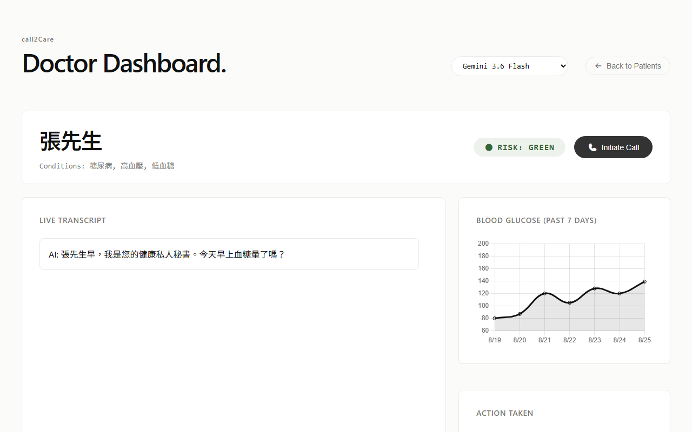
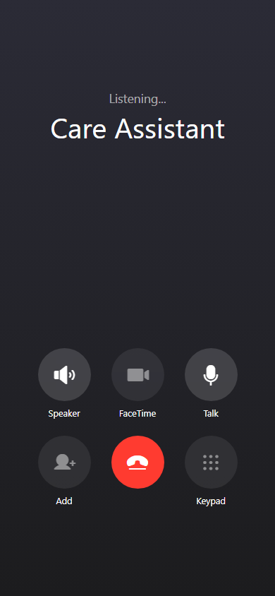

# Call2Care Demo

A voice-first AI care system designed for remote patient monitoring. The system uses a conversational AI assistant to conduct routine check-ins, assess clinical risks (GREEN, YELLOW, RED), and escalate high-risk events to a pharmacist or family member via a live dashboard.

<p align="center">
  
  &nbsp;&nbsp;&nbsp;
  
</p>

## Features
- **Dynamic Patient Context**: The LLM dynamically injects patient medical history (e.g., Diabetes, Hypertension) to personalize the conversation.
- **Live Triage Dashboard**: Real-time WebSockets stream the transcript and AI's clinical assessment to a dashboard.
- **RAG Medical Knowledge**: Ingests hospital educational PDFs and drug inserts to accurately advise patients on diet and medication.
- **Guardrails**: Strict prompt engineering ensures the AI refuses to modify prescriptions and forces human-in-the-loop escalation for RED events.

---

## 🚀 Step-by-Step Setup Guide

Follow these steps to run the presentation demo seamlessly across your presentation laptop and smartphone.

### 1. Prerequisites
Ensure you have the following installed on your machine:
- **Python 3.12+**
- **uv**: Fast Python package installer. (Install via `pip install uv`)
- **Git**
- **Ngrok**: Required to securely route your laptop's server to your phone's microphone. [Download Ngrok here](https://ngrok.com/download) or install via terminal (`winget install ngrok` on Windows, or `brew install ngrok/ngrok/ngrok` on Mac).

### 2. Get Your API Keys
You will need two free API keys to power the AI and Speech-to-Text:
1. **Google Gemini API Key**: 
   - Go to [Google AI Studio](https://aistudio.google.com/app/apikey)
   - Click "Create API Key" and copy it.
2. **Groq API Key**: 
   - Go to [Groq Console](https://console.groq.com/keys)
   - Click "Create API Key" and copy it.

### 3. Configure the Environment
1. In the root folder of this project, create a new file exactly named `.env`.
2. Open `.env` and paste your keys like this:
```ini
GEMINI_API_KEY=your_gemini_api_key_here
GROQ_API_KEY=your_groq_api_key_here
```

### 4. Install Dependencies
Run this command in your terminal to install all required Python packages:
```bash
uv sync
```

### 5. Initialize the Database (One-time only)
Populate the AI's medical knowledge base with the local PDF guidelines:
```bash
uv run python -m backend.ingest_pdfs
```

---

## 🎙️ How to Run the Demo

We have provided convenient scripts to launch the server and Ngrok automatically!

### 1. Launch the Server & Ngrok

**For Windows Users:**
Simply double-click the `start_demo.bat` file in your folder, or run this in your terminal:
```powershell
.\start_demo.bat
```
*(When finished, just close the terminal window or press `Ctrl+C`).*

**For Mac/Linux Users:**
Run the shell script in your terminal:
```bash
./start_demo.sh
```

### 2. Connect the Interfaces

When the script runs, it will launch an Ngrok screen in your terminal. Look for the **Forwarding URL** (it will look something like `https://abc-123.ngrok-free.app`).

**The Doctor/Family Dashboard (Presentation Laptop)**
- Open your laptop's browser and go to: 
  👉 `http://localhost:8000/static/dashboard.html`
- *This is the screen you project to your audience.*

**The Patient Mobile UI (Your Smartphone)**
- Open Safari or Chrome on your smartphone.
- Type in the **Ngrok URL** followed by `/static/index.html`.
  👉 *Example: `https://abc-123.ngrok-free.app/static/index.html`*
- *Because it uses secure HTTPS, your phone will allow microphone access.*

### 3. Start the Conversation

1. **Initiate the Call**: On the laptop dashboard, select a patient and click the **"Initiate Call"** button.
2. **Answer**: On your mobile phone, tap the green **"Accept"** button when the call rings.
3. **Talk**: Once connected, tap and hold the **"Talk"** microphone button on the phone to speak to the AI. Release it to send your response. 
4. **Watch it sync**: The dashboard will instantly transcribe the conversation, update the patient's clinical risk (Green, Yellow, Red), and plot their medical data live!
